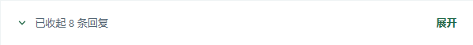

# 留白 · X 回复筛 1.0.5

**[下载安装包](https://github.com/Moss550wai/liubai-x/releases/latest)** · [压缩包安装与使用](INSTALL.md) · [开发全过程](docs/DEVELOPMENT.md) · [实验记录](docs/EXPERIMENTS.md) · [实现结构](docs/ARCHITECTURE.md)

1.0.5 已于 2026-11-20 提交 Edge Add-ons，后台状态为 **In review（审核中）**，尚未上线。此版补充商店简体中文语言声明，筛选行为沿用 1.0.3。当前可先下载安装包，加载 `extension` 文件夹使用；[提交记录](store/SUBMISSION.md)。

默认激进（阈值 0.30），沿用原有字符模型。所有分类在本机 CPU 完成，无接口、无密钥、无模型下载。

命中的回复从原位置收起，统一放在当前已加载内容的底部，只留一行 **「已收起 N 条回复 · 展开」**。点一次查看全部，再点一次收起；展开后是连续文字列表，没有逐条小格子和逐条展开按钮。后续评论加载时，统一入口跟随后移。正常评论保持 X 原样。

父帖作者的普通补充、串文默认保留；他回复已折叠内容时，一起归到底部，并注明「随上级收起」。统一展开只改变底部列表的显示，不把作者接话重新插回阅读流；对上级点「不该折叠」或加白名单时，作者接话联动恢复。白名单优先。

**已经加载上一版：** 不用卸载。保持原来的 `extension` 目录，在 Edge 的扩展管理页点击「留白」的「重新加载」，再刷新 X。设置、白名单和反馈继续保留。

## 安装：Chrome / Edge

1. 将安装包解压到一个固定目录，保留其中的 **extension** 文件夹。
2. 打开 `chrome://extensions`（Edge 用 `edge://extensions`），启用「开发者模式」。
3. 点击「加载已解压的扩展程序」，选择 **extension** 文件夹，然后刷新已打开的 X 页面。可把「留白」固定到工具栏。

本地版本不用 Python、Node 或显卡。后续更新覆盖同一个目录，再点扩展的「重新加载」并刷新 X。尽量不要移动扩展目录；删除扩展前先导出反馈。

## 日常用法

| 操作 | 结果 |
|---|---|
| 保守 / 标准 / 激进，或拖动强度 | 同一模型改变阈值；向右折叠更多，立即生效 |
| 底部「展开 / 收起」 | 一次展开或收起全部已归集回复，原位置不重复显示 |
| 展开列表中的「不该折叠」 | 本次页面恢复该条原位置，并保存本地「保留」反馈；不自动训练或加白名单 |
| 展开列表中的「保留账号」 | 加入本地白名单，恢复页面上的原回复；在面板中管理或移除 |
| 查看原回复 ↗ | 新标签页打开 X 原回复，查看图片、视频及原生互动 |
| 面板开关 | 暂停后恢复所有原文 |

**账号屏蔽完全由你在 X 里手动操作，插件没有屏蔽入口、没有菜单自动点击，也没有本地黑名单。** 白名单只影响留白，不改变 X 的关注和屏蔽关系。没有预设用户白名单，也没有代你屏蔽任何真实账号。

底部列表只展示当时从页面读取的文字，不克隆 X 的互动按钮或媒体。已归集的文字在 X 回收节点后仍可查看，滚动回来不会重复计数。换帖或刷新清空临时归集。每帖最多缓存 2,000 个命中项，达到上限后新命中项先保留可见；这份临时缓存不落盘，不随反馈导出。

## 字段、范围和数据

页面实际可读取：回复的当前可见文字、作者 @用户名、时间戳上的帖子链接；原帖通过当前详情页链接识别。引用卡片文字排除，图片不识别，不主动展开长文，不读取账号行为。正文、账号或链接读不到的回复保持显示。

父子关系来自 X 页面本来就请求的 `TweetDetail` 响应：仅提取帖子 ID 与 `in_reply_to_status_id_str`，不额外发送请求，不保存响应正文、请求头或登录凭证。页面脚本和扩展之间只传这对 ID。没有准确关系、上级未读过或缓存已淘汰时保留作者接话，绝不按相邻位置猜。父子关系最多缓存 4,000 对、当前帖评分最多记住 2,000 条；换帖重建评分记录，滚出视口的已读上级仍可参与判断。普通其他账号的回复继续独立按模型判断。

只处理帖子详情页的回复，原帖、上级帖子、首页和搜索结果保留。父帖指当前详情页对应的帖子，作者取其账号头部，不从引用卡片猜测；作者暂时读不到时先保留回复，读到后再处理。原帖滚出页面后仍记住其作者，换帖时重新识别。已识别的「发现更多」推荐区跳过；推荐边界离开 DOM 后，新出现但不能确认为回复的条目也保留。超过 12,000 字的回复不处理。插件不会判断作者是否真的用了 AI；接受误伤的同时仍会漏放。

设置、白名单和反馈都在当前浏览器配置的 `chrome.storage.local` 中，不用云同步。反馈字段为：原文、账号、链接、时间、用户「保留」判断、当时分数和阈值。本版另记 `foldReason`（模型命中 / 随上级折叠）及对应的 `parentId`，不会把联动折叠当成模型判错。旧记录保留。**面板 → 导出反馈**，下载含反馈、设置和白名单的 JSON。保存失败会提示，不会清空旧记录。

## 证据

- [三档取舍及已知误伤](thresholds.md)
- [功能、实机性能与限制](test-report.md)
- `qa-results.json`：本版隔离浏览器回归；本版布局截图为 `screenshots/collection-*.png`，真实 X 记录另见 `live-tray-1.0.3.json`。`live-results.json` 和 `screenshots/live-desktop.png` 等旧图为历史证据。
- `model-checks.json`：321 条与 Python 原模型的分数核对，无重新训练。
- [版本记录与回退方法](CHANGELOG.md)：Git 中保留各版标签，可回退比较。

Chrome/Edge 采用 Manifest V3，最低内核版本 120。测试使用独立 Chromium 配置，不修改日常浏览器。X 改版可能影响读取，识别失败的回复保持显示。
