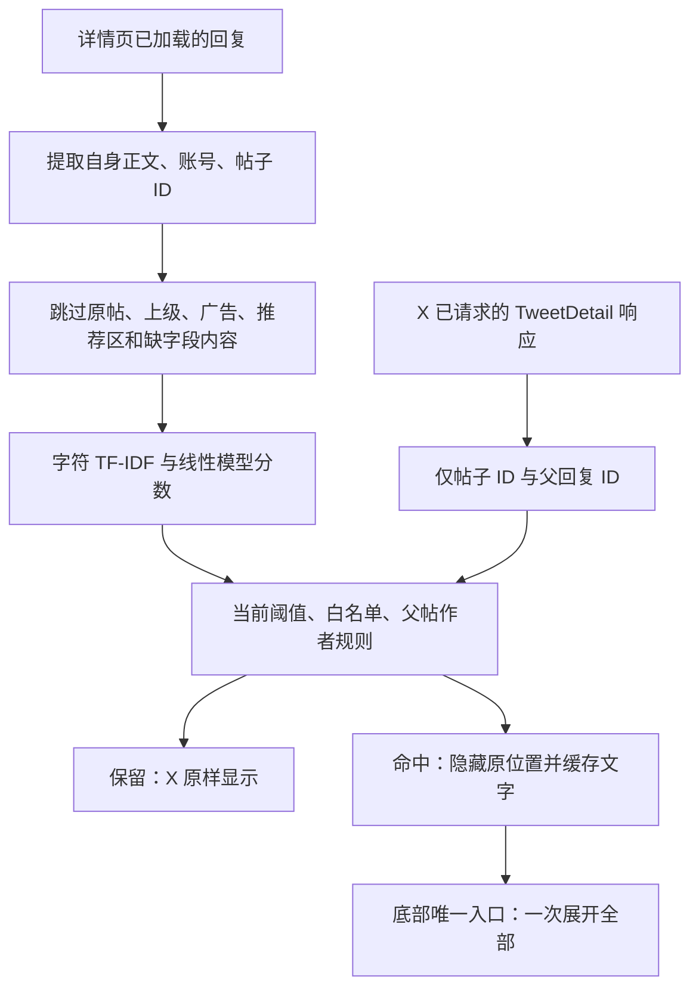

# 实现结构

## 一条回复如何处理

模型仅看单条回复文本。父子关系用于作者豁免的展示规则，**不把父帖正文或账号行为作为模型特征**。

## 文件分工

| 文件 | 职责 |
|---|---|
| `extension/model-data.js` | 词表、IDF、逻辑回归参数、源模型 SHA-256 |
| `extension/scorer.js` | 清洗、1–4 gram、TF-IDF/L2、点积与 sigmoid；无运行时依赖 |
| `extension/content.js` / `content.css` | 页面字段、范围、队列、临时归集、单一入口、纠错/白名单交互 |
| `extension/parents.js` | MAIN world 中只读旁路已发出的响应，提取 ID 对；内容脚本启动后可重放缓存 |
| `extension/background.js` | 校验消息来源/字段，串行写本地设置、白名单、反馈，处理导出 |
| `extension/popup.*` | 三档/滑块、总开关、白名单管理、反馈导出 |
| `extension/help.*` | 随包离线说明 |
| `qa/` | 隔离浏览器合成测试、响应读取契约检查、打包 |

## 字段与限制

正文从自身 `tweetText` 读取，排除引用卡片；作者从自身 `User-Name` 链接读取；ID 从自身时间链接读取。显示被缩短的外链会用实际 href 归一化评分，反馈仍保留用户看到的文字。图片不做 OCR，长文不自动展开；超过 12,000 字的回复先保留。

作者由当前详情页原帖的账号头部确认，不从引用卡片猜；作者头部未到达时先保留。原帖滚出 DOM 后记住作者，路由换帖清空。作者普通串文豁免；准确父链指向已折叠内容时一起归集，未知关系不猜。

只给单条 article/虚拟容器加 data 标记，不移动 X 管理的原节点。底部保存安全文本，不复制原始 HTML、事件处理器或媒体。消息桥只接受同源同窗、当前路径、限定长度和数字 ID 形状的数据；它不能触发存储或账号操作。

## 本地数据

持久化仅使用 `chrome.storage.local`：设置、白名单和主动纠错反馈。无云同步、遥测、自动上传或自动重训。反馈导出由用户点击触发。

临时缓存按当前帖清理：父子关系最多 4,000 对，评分记录最多 2,000 条，归集命中最多 2,000 条。命中缓存到上限后新的条目保持可见；换帖/刷新不把临时正文写入硬盘。未知或淘汰的父关系保留，不误用邻居关系。

## 权限与网络

Manifest V3，仅申请 `storage`，内容脚本限 `https://x.com/*` 与 `https://twitter.com/*`。扩展没有模型服务、账号屏蔽 API、网络推理或远程依赖；X 网页本身仍会联网。

MAIN world 与页面共享环境，X 改版或页面干预可使关系读取失效。关系失效时回到保留策略；这不是一个独立于 X DOM/API 的通用检测服务。
